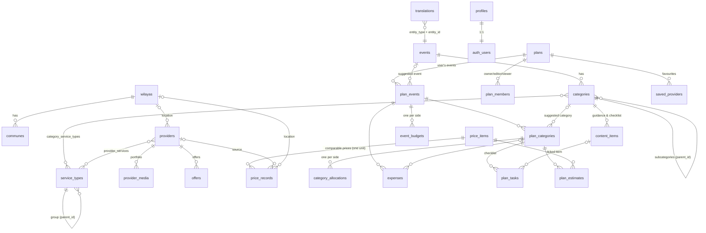

# Data model

Source of truth: `supabase/migrations/*.sql` (applied in filename order).
TypeScript mirror: `src/data/types.ts`.

All IDs are UUIDs. Display names are never used as keys.
`enabled` hides rows from users without deleting them; `is_demo` marks
fictional sample data so it can be removed safely.

## Content tables (admin-managed)

| Table | Purpose | Key columns |
|---|---|---|
| `wilayas`, `communes` | Regions | `code`, `slug`, `sort_order`, `enabled` |
| `events` | Jehaz, Choufa, … | `slug` (unique), `side`, `icon`, `sort_order` |
| `categories` | Per-event categories; `parent_id` → subcategory | `event_id`, `side`, `slug` unique per event |
| `content_items` | Checklist items, suggestions, tips, traditions, notes, images | `kind`, `importance` (essential/optional/regional), `wilaya_id` |
| `service_types` | Provider types; `parent_id` groups them | `slug` |
| `category_service_types` | Which providers/prices a category shows | composite PK |
| `providers` | Directory | `name`, contacts, `wilaya_id`, `commune_id`, `featured`, `verified`, `last_updated_at` |
| `provider_services` | Extra services of a provider | composite PK |
| `provider_media` | Portfolio images/videos | `url`, `storage_path`, `sort_order` |
| `offers` | Offers with validity dates | `valid_from ≤ valid_to` (constraint) |
| `price_items` | ONE comparable product/service, ONE unit | `unit` ∈ piece, kg, person, hour, day, package, event, quote |
| `price_records` | A low–high price for an item | `min_price ≤ max_price`, `min_quantity`, `price_status`, `updated_on`, provider **or** `source_label` required |
| `translations` | Text per entity × field × language | unique (`entity_type`,`entity_id`,`field`,`lang`) |
| `ui_translations` | Overrides of interface text | PK (`key`,`lang`) |

Translatable fields: events/categories `name, description`; content items
`title, body`; providers `description, services_text, service_area,
availability_notes`; offers `title, description`; price items `name,
description`; price records `conditions, extras`; media `caption`; regions `name`.

## Personal tables (per user)

| Table | Purpose |
|---|---|
| `profiles` | Name, preferred language, **role** (`user`/`editor`/`admin`) |
| `plans` / `plan_members` | One plan per user; members ready for future collaboration |
| `plan_events` | The user's event list: suggested (`event_id`) or custom; `custom_name`, `side`, order, `enabled`, `removed_at`, notes |
| `plan_categories` | Overrides of suggested categories, or custom ones |
| `event_budgets` | Total for ONE event and ONE side (unique per event+side) |
| `category_allocations` | Planned amount per category and side (≥ 0) |
| `expenses` | Paid or committed amounts (> 0) |
| `plan_tasks` | Ticked checklist items and custom tasks |
| `plan_estimates` | Saved quantity × price-item estimates |
| `saved_providers` | Favourites |

There is **no** table, column or view for a wedding-wide budget.

## Integrity

* Foreign keys with `cascade` for owned children, `set null` for references
  that must survive deletion (e.g. a user's expense keeps existing if a provider is deleted).
* Check constraints on sides, units, kinds, amounts (non-negative / positive), date order.
* Triggers: `updated_at` maintenance, translation cleanup on delete, profile
  creation on sign-up, plan owner membership.
* Indexes on every foreign key used for lookups.
